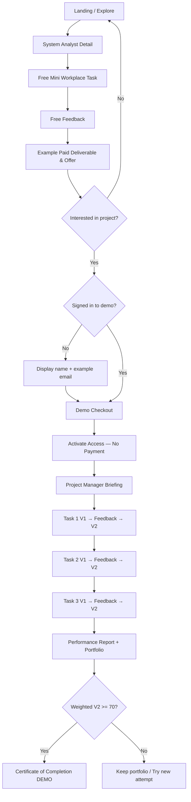

# User Flow — From Free to Evidence

## Route map

| Route | Auth | Access | Description |
|---|---|---|---|
| `#/home` | No | Public | Value proposition, how-it-works, call to action |
| `#/explore` | No | Public | Search role/company/category/status |
| `#/detail/:id` | No | Public | Case, tools, sample deliverable, price |
| `#/free` | No | Public | Real decision task, three structured choices |
| `#/free-result` | No | Completed free task | Honest feedback + example premium output |
| `#/auth` | No | Demo identity | Display name + example email (no password) |
| `#/checkout/system-analyst` | Yes | Demo checkout | Payment method illustration, no payment |
| `#/welcome` | Yes | Entitlement | Briefing and start of attempt |
| `#/workspace/:taskId` | Yes | Entitlement | V1/V2, form, artifact, feedback |
| `#/dashboard` | Yes | Session | Progress and reset control |
| `#/report` | Yes | All V1/V2 | Scores, rubric, weighted outcome |
| `#/portfolio` | Yes | All V1/V2 | Side-by-side artifact versions + export |
| `#/certificate` | Yes | All V1/V2 + score >=70 | Download SVG or print |

## Critical behaviors

- Free challenge can be repeated; result is overwritten by newest response, never manipulated to force sale.
- Auth returns to previously requested route (checkout/deep-link), preserving completed free result.
- Checkout available only for System Analyst, entitlements are scoped by demo email.
- Changing role/portfolio must not discard active attempt. Refresh preserves draft/finished snapshots.
- Task N+1 blocked until Task N has V2; cannot jump past unanswered tasks.
- Score only after submit. V2 may be lower than V1; delta displayed as signed number.
- Users with score below 70 still retain report & portfolio; can retry new attempt. Old attempts remain in browser local data but UI only shows active one.
- Certificate is an unverified local DEMO, not professional credential.
